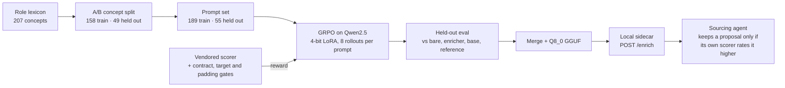

# boolean-search-rl

A strong sourcer writes a Boolean search string in the language candidates use about themselves. When one profile uses an abbreviation like LoRA and another spells out low-rank adaptation, the string carries both, along with the plurals, verb forms, and hyphenated and spaced spellings. When a query lists specific names, such as benchmarks or training frameworks, it gets joined to the general class it belongs to, so the search finds people who work in that area rather than anyone who happens to mention one of the names. This repository trains a small language model with reinforcement learning — trial-and-error training graded by the same scorer the autonomous sourcing agent applies to its own strings — to make those two kinds of additions.

The agent already has a rule-based enricher that adds spellings from its dictionary, but it can only reuse words already declared for a concept and never proposes a general class for a list of names. On test prompts built from concepts the model never saw during training, that dictionary enricher left every string unchanged. Evaluated across all 55 held-out prompts on 23 September 2026 by taking the best of eight suggestions per prompt, the trained model improved on the enricher's string on 50 prompts, tied on 5, and made none worse.

I am a recruiter, not a machine-learning engineer, and I designed the training setup and built it by directing AI coding agents.

> Curated public snapshot as of 15 October 2026. Private development history, working plans, model weights and run directories are omitted.

## System architecture and design choices



### Holding out whole concepts so evaluation tests sourcer judgment, not memorization

If a model is rewarded during training for every term in a role lexicon and tested on prompts from that same vocabulary, it can pass by memorizing a word list while failing when a hiring manager asks for an unfamiliar library or subfield. Before prompts are built, `build_split` cuts the 207-concept `research-engineer-post-training` lexicon (`SEED = 20260921`, `HOLDOUT_SHARE = 0.25`) into 158 Set A training concepts and 49 Set B held-out concepts, stratified by family so every family with two or more eligible concepts yields at least one while no Set A family is emptied. Penalty vocabulary (`protected_ids`) stays in Set A on both sides so holding out a concept never disables a penalty, and `tests/test_split.py` asserts that the Set A reward lexicon resolves zero Set B spellings in [`cloris_boolean_rl/data/split.py`](cloris_boolean_rl/data/split.py).

### Rewarding real synonym groups while blocking the sixty-term padding trick

A strong sourcer writes a focused `OR` group of genuine synonyms, whereas a policy graded purely on concept coverage quickly learns that dumping dozens of common words into one group games the score: against Set A, a 60-term dump composites at 0.514, beating a bare term's 0.413 because the parsimony multiplier charges rare forms, grab-bags, wasted gates, and length rather than raw term count. To close that loophole, `explain_task1` and `explain_task2` score completions in log space (`ScoreReport.log_composite`) behind three gates that floor violations at `math.log(1e-6)` (-13.8155): `extract_group` requires one parenthesized positive `OR` group with no prose or nested `AND` or `NOT`, the target gate requires matching the prompt's concept or sweep family, and the padding gate caps each group at `MAX_TERMS = 16` terms and `MAX_CONCEPTS = 5` concepts in [`cloris_boolean_rl/reward/tasks.py`](cloris_boolean_rl/reward/tasks.py).

### Checking the scorer against blind AI raters and adversarial strings before training

A policy is only as good as its grader, so the hand-set scorer weights were tested against two independent AI raters, working blind from the same sourcing doctrine, and against adversarial inputs before spending GPU hours. `fit_boolean_scorer_weights.py` exports features for 164 strings and runs 5-fold cross-validation repeated 10 times against blind-rater targets on 52 in-role strings under three guardrails: the two-group `EXEMPLAR` must score at least 0.85 and rank in the top tenth of the 76-string corpus, all 10 adversarial strings must score below the corpus median, and the full-lexicon dump must score below 0.10. The shipped scorer correlates with the raters at a held-out Spearman of 0.574 (0.612 in-sample), short of the 0.80 bar the calibration file sets, but it clears every guardrail and no refit did better held out, whereas linear and multiplicative refits bought higher in-sample correlations (0.662 and 0.661) by driving structure or employer-gate penalties to zero and lifting the lexicon dump to 0.517 and 0.208 in [`calibration/fit_boolean_scorer_weights.py`](calibration/fit_boolean_scorer_weights.py).

### Serving quantized GGUF candidates behind a keep-only-if-better sidecar contract

A live query rewriter cannot take three minutes per search string on a laptop or replace a working query with a worse one. `tools/export_gguf.py` merges the release LoRA adapter into `Qwen/Qwen2.5-3B-Instruct` in fp16 on CPU and converts it via `convert_hf_to_gguf.py` into a 3.3 GB `Q8_0` GGUF file (96 seconds on an M4 MacBook Air), cutting 8-candidate generation through `llama-server` on Metal from 185 seconds on `transformers` to 3.9–7.2 seconds per request. `serve_sidecar.py` exposes `GET /health` and `POST /enrich` using the training prompt builders (`build_messages`) and matched sampling (`LLAMA_SAMPLING`) without scoring anything itself; the sourcing agent rescores every proposal and keeps a rewrite only when `log_composite` improves by more than 0.01 in [`cloris_boolean_rl/serve/sidecar.py`](cloris_boolean_rl/serve/sidecar.py).

### Recorded results on the 55 held-out prompts

These numbers were recorded at the end of each run on 22 and 23 September 2026 and are collected in [`results/eval-summary-re-v3-3b-ck100.json`](results/eval-summary-re-v3-3b-ck100.json). A system's score on a prompt is its best of N samples at temperature 0.8, in log-composite units, and a win or loss needs a margin of more than 0.01 log units.

| System | Samples per prompt | Mean, all 55 | Mean, 28 register | Mean, 27 anchor | Against the enricher (win / loss / tie) |
|---|---:|---:|---:|---:|---:|
| Untouched input | — | -6.793 | -0.862 | -12.944 | 0 / 0 / 55 |
| Deterministic enricher | — | -6.793 | -0.862 | -12.944 | — |
| Qwen2.5-3B-Instruct, untrained | 8 | -1.991 | -0.968 | -3.052 | 38 / 1 / 16 |
| re-v1: Qwen2.5-1.5B, 100 steps | 4 | -2.764 | -2.550 | -2.986 | 31 / 5 / 19 |
| re-v2-3b: Qwen2.5-3B, 200 steps | 8 | -0.462 | -0.566 | -0.355 | 48 / 0 / 7 |
| re-v3-3b: Qwen2.5-3B, checkpoint 100 | 8 | -0.248 | -0.561 | 0.077 | 50 / 0 / 5 |
| re-v3-3b: Qwen2.5-3B, checkpoint 200 | 8 | -0.461 | -0.565 | -0.352 | 50 / 0 / 5 |
| Reference answer from the full lexicon | — | 0.170 | -0.352 | 0.710 | 55 / 0 / 0 |

## Quickstart and reference

The CPU tier needs only the Python 3.12 standard library and `pytest`:

```bash
uv venv --python 3.12 .venv
uv pip install -e '.[core]'

.venv/bin/python -m pytest tests/                     # 142 passed, 3 skipped without the train extras
.venv/bin/python tools/build_split.py --check         # the A/B concept split is current
.venv/bin/python tools/build_prompts.py --check       # the prompt set is current
.venv/bin/python tools/run_eval.py                    # deterministic baselines, no GPU
.venv/bin/python calibration/fit_boolean_scorer_weights.py
.venv/bin/python tools/serve_sidecar.py --fake        # the sidecar contract, no torch
```

To serve or export a trained adapter:

```bash
.venv/bin/python tools/serve_sidecar.py --adapter <release dir>/adapter
.venv/bin/python tools/export_gguf.py --adapter <release dir>/adapter \
  --out <release dir>/gguf --quant Q8_0 --llama-cpp /path/to/llama.cpp
.venv/bin/python tools/serve_sidecar.py --gguf <release dir>/gguf/model-Q8_0.gguf
```

### Further reading

- [`docs/technical-reference.md`](docs/technical-reference.md) — the full technical description: every mechanism, constant and file, and how correctness is verified.
- [`results/eval-summary-re-v3-3b-ck100.json`](results/eval-summary-re-v3-3b-ck100.json) — recorded evaluation summary for the table above.

## How it was built

I built this repository as a senior technical recruiter directing AI coding agents under a written plan before each slice and tests that assert the held-out split, prompt disjointness, and reward gates as identities. I ran the GRPO training on Colab GPUs and the GGUF export and serving work on a laptop.

## License

MIT License. See [`LICENSE`](LICENSE).
