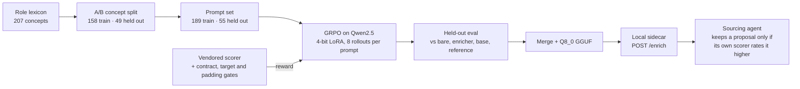

# boolean-search-rl

GRPO training of a small language model to improve LinkedIn Recruiter Boolean search strings, graded by a deterministic scorer, held out by concept, and served back to a sourcing agent as a local HTTP sidecar.

> Curated public snapshot as of 15 October 2026. Private development history, working plans, model weights and run directories are omitted.

## The problem it trains on

The companion repository, [`long-horizon-sourcing-agent`](https://github.com/sam-vangelos/long-horizon-sourcing-agent), has a language model write LinkedIn Recruiter Boolean strings. A scorer grades each string against a role lexicon, and a deterministic enricher already fixes the mechanical half of what is wrong: on the agent's in-role corpus it lifts the composite score from 0.53 to 0.73 and variant coverage from 0.42 to 0.97, and it makes nothing worse anywhere. This repository trains a small policy on the half the enricher cannot reach.

Two behaviours are left, and both are string-only, single-shot, and checkable by the scorer rather than by a person.

**Register generalisation.** Given a bare term or a thin group whose concept the lexicon does not list, write the OR group a good sourcer would write — the acronym beside the spelled-out phrase where both are written, the plural, the colloquial short form, the verb and tense forms, the hyphenated spelling and its spaced twin. The enricher cannot do this because it invents nothing: every term it writes was already declared for a concept the author chose. On the 55 held-out prompts the enricher's answer is identical to the untouched input in every case — 0 wins, 0 losses, 55 ties. That is the headroom, stated exactly.

**Anchor proposal.** Given an anchorless sweep of named things, propose the general class group to AND with it, so the string's shape becomes anchor-and-sweep. In the agent's scorer residue tables this is the largest remaining defect on every corpus measured — `missing_anchor` on 8 of 51 in-role strings, 16 of 76, and 255 of 491 — and no amount of adding spellings creates an anchor.

Nothing here calls a paid API or writes into the sourcing agent. The scorer is vendored by copy, and the trained adapter goes back as a release file behind a local service.



## The held-out concept split

The lexicon's 207 concepts are cut into A (158) and B (49), seeded and stratified by family, so no family is emptied and every family with two or more eligible concepts gives up at least one. Umbrella and generic concepts — the words the scorer charges — stay in A on both sides, because holding one out would switch off a penalty rather than hold out a concept.

The training reward reads A only. It cannot resolve a single held-out surface form, and `tests/test_split.py` asserts that as an identity. Training prompts target A only and eval prompts target B only; a prompt whose concepts straddle the split is dropped rather than assigned, and a further test asserts that no held-out spelling appears anywhere in a training prompt's text, not merely that the concept ids are disjoint. The register eval reward reads B only, so memorised A vocabulary is invisible to it.

The anchor eval reward reads the whole lexicon, deliberately. The held-out thing in an anchor prompt is the sweep; the answer is general class vocabulary the split may have left in A, and a B-only lexicon would floor a correct anchor for being correct in A's words. The generalisation claim there rests on the sweep side plus a family gate: the proposed anchor must be the right class for a set of names the policy was never paid to recognise.

The split (`cloris_boolean_rl/data/splits/re-v1.json`) and the prompt set (`cloris_boolean_rl/data/promptsets/re-v1.json`) are committed artifacts, and `tools/build_split.py --check` and `tools/build_prompts.py --check` fail if either drifts from what the code would build.

## The reward and its three gates

The reward is `ScoreReport.log_composite` from the vendored scorer (`cloris_boolean_rl/scorer/`). It works in log space because the composite is a product and GRPO normalises advantages within each group of rollouts, so a multiplicative reward would make any improvement on a bad completion invisible.

Three gates sit on top (`cloris_boolean_rl/reward/tasks.py`), because the scorer judges strings a person wrote and this judges strings a policy is being paid to write:

1. The output contract: one parenthesised OR group and nothing else. Prose, a second group, a NOT, a wildcard or a lowercase operator all floor.
2. The target: a register completion that names none of the prompt's concepts floors, and so does an anchor whose family does not reach the sweep's.
3. The padding gate, which exists because of a measured hole. Against the A lexicon, a sixty-term dump of common surfaces composites at 0.514 — above an honest bare term's 0.413 — because the scorer's parsimony term charges rare forms, grab-bags, wasted gates and characters, but nothing for the number of terms in a group. On a coverage-weighted reward that makes "say every word you know" a rising gradient, and it is the first thing a GRPO policy finds. A completion may name at most 16 terms (`MAX_TERMS`) and at most 5 concepts (`MAX_CONCEPTS`), all sharing a family with the target.

Every floor is the scorer's own zero, `log(1e-6)`. For the anchor task, whose reward is the delta `log_composite(anchor AND sweep) - log_composite(sweep)`, the floor is that zero minus the sweep's own score. There are no invented constants.

Diversity is measured and never rewarded. Distinct term sets and mean pairwise Jaccard across each prompt's samples go in the eval report as the mode-collapse tell (`cloris_boolean_rl/eval/metrics.py`); rewarding them would fix a symptom and break the reward, because variety is not a virtue in a search string. During training the guards against reward hacking are the ones above plus the KL penalty (beta 0.04 on every run, never zero) and the logged `reward_std`: a rising mean with `reward_std` collapsing to zero is mode collapse, not learning.

## Recorded results on the held-out prompts

These numbers come from the eval JSON written at the end of each run on 22 and 23 September 2026, collected in `results/eval-summary-re-v3-3b-ck100.json`. They cannot be re-measured without a GPU and the adapters, which do not ship. Every run trained on the same 189 Set A prompts with 8 rollouts per prompt, LoRA rank 16, 4-bit base weights and beta 0.04, and every eval scores the same 55 Set B prompts (28 register, 27 anchor). A system's score on a prompt is its best of N samples at temperature 0.8, in log-composite units; a win or loss needs a margin of more than 0.01 log units, about 1% relative.

| System | Samples per prompt | Mean, all 55 | Mean, 28 register | Mean, 27 anchor | Against the enricher (win / loss / tie) |
|---|---:|---:|---:|---:|---:|
| Untouched input | — | -6.793 | -0.862 | -12.944 | 0 / 0 / 55 |
| Deterministic enricher | — | -6.793 | -0.862 | -12.944 | — |
| Qwen2.5-3B-Instruct, untrained | 8 | -1.991 | -0.968 | -3.052 | 38 / 1 / 16 |
| re-v1: Qwen2.5-1.5B, 100 steps | 4 | -2.764 | -2.550 | -2.986 | 31 / 5 / 19 |
| re-v2-3b: Qwen2.5-3B, 200 steps | 8 | -0.462 | -0.566 | -0.355 | 48 / 0 / 7 |
| re-v3-3b: Qwen2.5-3B, checkpoint 100 | 8 | -0.248 | -0.561 | 0.077 | 50 / 0 / 5 |
| re-v3-3b: Qwen2.5-3B, checkpoint 200 | 8 | -0.461 | -0.565 | -0.352 | 50 / 0 / 5 |
| Reference answer from the full lexicon | — | 0.170 | -0.352 | 0.710 | 55 / 0 / 0 |

The anchor column carries most of the movement. The enricher proposes no anchor, so it takes the floor on all 27 anchor prompts; the untrained 3B model clears the gates on some of them; and checkpoint 100 of re-v3-3b is the first system with a positive mean, meaning its proposed anchors raise the string's score on average. Against the untrained 3B model it wins 30 of 55 prompts, loses 1 and ties 24.

Between re-v2-3b and re-v3-3b the run configuration differs in one setting: the rollout temperature went from 0.9 to 1.0. re-v2-3b's eval shows why that mattered. On 7 of the 55 held-out prompts all eight of its samples were the same group, and its samples averaged 5.6 distinct term sets per prompt; re-v3-3b's checkpoint 100 had no collapsed prompts and 7.18 distinct sets, against 7.31 for the untrained model. Its checkpoint 200 kept the register score and gave back the anchor gain (0.077 to -0.352), so checkpoint 100 is the release candidate the sidecar serves.

## The return path: GGUF and the sidecar

The trained adapter goes back to the sourcing agent as a local HTTP service, so the agent gains one client and no torch. `tools/serve_sidecar.py` builds the model's messages with the same `cloris_boolean_rl/data/doctrine.py` functions training used, samples, and returns every raw completion beside the group `extract_group` reads out of it, or null when the completion broke the one-group contract. It judges nothing. `GET /health` reports the model, the adapter label and the device; `POST /enrich` takes the task (`register` or `anchor`) and `given`, the group text exactly as the agent authored it, plus an optional `n` (1 to 32, default 8), `temperature` (default 0.8, the eval's setting) and an integer `seed`. A malformed request is a 400, a generator failure a 500 and an unknown path a 404, each with a JSON `detail`. `--fake` answers the same contract with deterministic candidates built from the given's own terms, one legal group and one prose answer among them, without importing torch.

On a GPU the sidecar serves the adapter through transformers and PEFT. On a Mac it serves a merged GGUF through llama.cpp on Metal: `tools/export_gguf.py` merges the adapter into the base model on the CPU in fp16, converts it with llama.cpp's `convert_hf_to_gguf.py` straight to Q8_0, checks that the GGUF carries the tokenizer's own chat template, and writes `EXPORT.json` beside it with the adapter label, the base model, each file's size and SHA-256, and the llama.cpp commit. The export took 96 s on an M4 MacBook Air (28 s to merge, 59 s to convert) and wrote a 3.3 GB file. `--gguf` starts `llama-server` on 127.0.0.1:8790 with every layer on Metal and eight slots, and the sidecar names the sampler the transformers path inherits from Qwen2.5's generation config (top_k 20, repetition penalty 1.05) under the same temperature, top_p 0.95 and 128-token cap, because llama-server's own defaults differ. For the register prompt on `"evaluation"` the prompt llama-server renders and its 713 token ids are identical to what `apply_chat_template` produces.

Measured on the same machine through `POST /enrich`, eight candidates per request took 7.2 s for the first register request, 4.5 s and 5.2 s with the prompt cached, and 3.9 s for an anchor request. The transformers path on the same laptop took 185 s for eight, which is why the GGUF path exists. All eight GGUF candidates for the held-out prompt `lex-bare-llm-evaluation` score -0.465 on `explain_task1`, the reference's value, as all eight from the transformers path did in the eval that picked this checkpoint.

On the agent's side (`linkedin/boolean_sidecar.py` in `long-horizon-sourcing-agent`, behind `LINKEDIN_ENRICHER_SIDECAR_ENABLED`, off by default), every candidate is rescored by the agent's own copy of the scorer and kept only when the whole string's `log_composite` beats the current string by more than 0.01. A dead sidecar trips a breaker and the plan goes out exactly as the deterministic enricher left it.

## Calibrating the scorer the reward depends on

A reward is only as good as its grader, so the scorer's hand-set weights were checked against blind raters before any training. `calibration/fit_boolean_scorer_weights.py` exports the scorer's features for 164 strings, then fits alternative weightings to blind-rater targets on 52 in-role strings with 5-fold cross-validation repeated 10 times, and rejects any fit that breaks a guardrail: the hand-written two-group exemplar must score at least 0.85 and rank in the top tenth of the 76-string corpus, every one of the 10 adversarial strings must score below the corpus median, and the adversarial string that lists every form in the lexicon must score below 0.10.

The hand-set weights held up. As shipped, the scorer's rankings correlate with the raters' at a held-out Spearman of 0.574 (0.612 in-sample). A sign-constrained linear refit reaches 0.662 in-sample but falls to 0.337 held-out, and it breaks two guardrails: the exemplar drops to 0.775 and the lexicon dump rises to 0.517. A refit of the multiplicative weights matches the shipped held-out 0.574 with a better in-sample 0.661, but it lets `adversarial-04` reach the corpus median of 0.590 and lifts the lexicon dump to 0.208. Both refits buy their in-sample gain by driving penalties to zero — the linear fit drops every structure penalty, the multiplicative fit both employer gates — and the adversarial strings exist to catch exactly that, so the shipped composition stays.

## Running it

The CPU tier needs only the standard library and pytest; the vendored scorer imports nothing.

```bash
uv venv --python 3.12 .venv
uv pip install -e '.[core]'

.venv/bin/python -m pytest tests/                     # 142 passed, 3 skipped without the train extras
.venv/bin/python tools/build_split.py --check         # the A/B concept split is current
.venv/bin/python tools/build_prompts.py --check       # the prompt set is current
.venv/bin/python tools/run_eval.py                    # deterministic baselines, no GPU
.venv/bin/python calibration/fit_boolean_scorer_weights.py
.venv/bin/python tools/serve_sidecar.py --fake        # the sidecar contract, no torch
```

`uv pip install -e '.[core,train]'` adds torch, transformers, TRL, PEFT, datasets and accelerate, after which `python -m cloris_boolean_rl.train.grpo --smoke` runs two GRPO steps on the CPU in about three minutes.

`tools/sync_scorer.py --check --cloris <path to long-horizon-sourcing-agent>` re-reads the agent's `linkedin/boolean_score/` and exits non-zero on any drift in the vendored copy; `--apply` re-copies it and rewrites `cloris_boolean_rl/scorer/VENDORED_FROM.json`.

### Training on a free Colab T4

Open `notebooks/colab_grpo_first_run.ipynb`, set the runtime to T4 GPU, and run the eight cells in order. Cell 2 clones this repository over plain HTTPS. If Colab cannot reach GitHub, it falls back to a bundle: make one with `python -m cloris_boolean_rl.train.colab_first_run --bundle` and put the zip in Drive at `MyDrive/boolean-search-rl/rig.zip`. The cells are generated from `cloris_boolean_rl/train/colab_first_run.py`, which is the source of truth; regenerate the notebook with `python -m cloris_boolean_rl.train.colab_first_run --write-notebook` rather than editing the JSON.

| Cell | What it does | Stop if |
|---|---|---|
| 1 install | Unsloth's matched torch/transformers set for the T4, with TRL pinned to 1.13.0 | CUDA is not visible |
| 2 checkout | Clone or pull this repository, mount Drive, check the vendored scorer | the scorer has drifted |
| 3 verify | `pytest tests/`, then `--check` the split and the prompt set | anything is red |
| 4 baselines | Deterministic eval on the held-out prompts, into `runs/eval/before.json` | — |
| 5 smoke | Two GRPO steps on the 0.5B model, then the 1.5B's contract pass rate on eight held-out prompts | it does not reach step 2, or the pass rate is 0 |
| 6 train | 1.5B 4-bit, LoRA r=16, G=8, `--max-steps 100`, checkpoints every 25 steps to Drive | mean reward is flat after 30 steps |
| 7 eval | Base and checkpoint over the held-out prompts, 8 samples each, into `runs/eval/after.json` | — |
| 8 release | Zip adapter, both evals, run config and split into `release/` and copy to Drive | — |

A dropped session resumes rather than restarts: put the last checkpoint back under the run directory and rerun cell 6 with `--resume-from <run dir>/checkpoint-75` added, keeping `--max-steps 100`, because that is the run's total, not what remains. Set `CLORIS_RL_WANDB=1` for Weights & Biases; leave it unset and nothing is reported anywhere.

What to watch in cell 6, in order of how much it matters: `reward` rising while `reward_std` stays above zero; `kl` staying bounded, since a runaway KL means the policy is walking off to game something; and the two completions logged per step, which should look like OR groups — when they start to look like word lists, the padding gate is being probed.

To serve a trained adapter:

```bash
.venv/bin/python tools/serve_sidecar.py --adapter <release dir>/adapter
.venv/bin/python tools/export_gguf.py --adapter <release dir>/adapter \
  --out <release dir>/gguf --quant Q8_0 --llama-cpp /path/to/llama.cpp
.venv/bin/python tools/serve_sidecar.py --gguf <release dir>/gguf/model-Q8_0.gguf
```

Homebrew's llama.cpp does not ship the converter, so `--llama-cpp` names a checkout (a shallow clone is made there when the script is missing), and the converter also needs `gguf` and `sentencepiece` in this environment.

## Findings from building it

1. A hard floor has a cold-start cost, and the CPU smoke measured it. Two GRPO steps with Qwen2.5-0.5B wrote a checkpoint and taught the model nothing: reward -13.82 then -13.18, `reward_std` 0 on both, `grad_norm` 0. All eight completions floored, so every advantage was zero, and they floored for one reason — the 0.5B writes ANDs, not OR groups. GRPO learns from the spread inside a group, and a group where everything floors has none. Hence cell 5, which measures the 1.5B's contract pass rate before the hours are committed. One over-strictness was removed on the strength of it: `extract_group` used to refuse any completion carrying a parser warning, but an unquoted token is already charged through the structure term, so refusing it double-charged the defect and flattened a whole band of near-misses into the same floor as prose — precisely the spread GRPO needs.
2. Occasional forms earn nothing once the common register is complete. Register coverage is `min(1.0, hits/expected) + 0.05 x occasional`, and the clamp bites first. Fourteen of forty candidate held-out register prompts had zero headroom — the reference and the untouched input scored identically to four decimals — so they are filtered out of the prompt set.
3. A reference built from declared forms can score below its own input. `("LoRA" OR "low-rank adaptation")` scored -0.393 against the bare `("LoRA")`'s -0.322, because the hyphen twin is derived rather than declared and its absence is charged on the variant axis. Every reference is now run through the enricher.
4. Seven of twenty-three lexicon families have no class concept and no parent that has one — datasets, model names, training frameworks, app frameworks, venues, vector stores and cloud platforms. A sweep of their members has no anchor the scorer can read, so those anchor prompts cannot exist.
5. Umbrella concepts make unanswerable register prompts. The enricher lifted 27 of 27 non-umbrella listed concepts and 0 of 21 umbrella ones, because it is forbidden to add those words and the scorer charges a group made of them. A prompt whose best answer is a penalised group teaches the penalty.

## Repository layout

```
cloris_boolean_rl/
  scorer/      vendored copy of the agent's linkedin/boolean_score/, byte for byte,
               with VENDORED_FROM.json recording the file list and each file's SHA-256
  data/        split.py (the A/B split), prompts.py (the prompt sets), doctrine.py
               (the instruction block and output contract), the committed split and
               prompt set, and the string corpora the prompts are mined from
  reward/      lexicons.py (which lexicon each reward reads) and tasks.py (the two
               rewards and their gates)
  eval/        baselines, metrics (win rates, diversity, gate tallies), the harness,
               and lazy sampling
  train/       grpo.py (the TRL GRPOTrainer configuration and --smoke) and
               colab_first_run.py (the notebook cells and generator)
  serve/       sidecar.py (the HTTP service and its three backends)
calibration/   the blind-rater targets, the feature export and the weight fit
tools/         build_split, build_prompts, run_eval, serve_sidecar, export_gguf,
               sync_scorer, colab_refresh
results/       the recorded held-out evaluation summary
tests/         the split, the prompts, the reward, the eval, the trainer wiring,
               the sidecar and the vendoring
```

## How it was built

This repository was built by a recruiter directing AI coding agents, under the same discipline as its companion: a written plan before each slice, and tests that assert the held-out guarantees as identities rather than spot checks. The training runs were done on Colab GPU sessions and the export and serving work on a laptop.

## License

MIT License. See [`LICENSE`](LICENSE).
